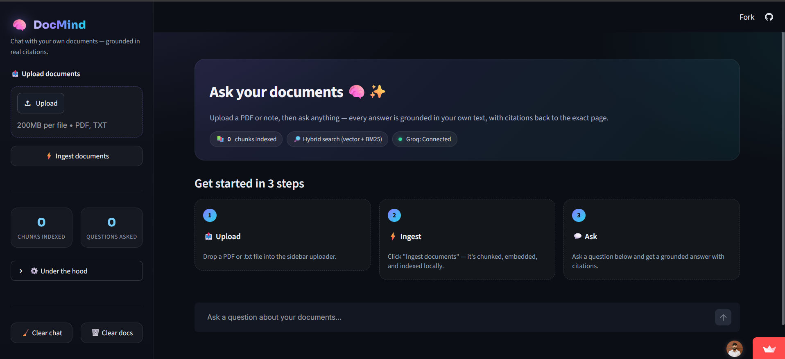
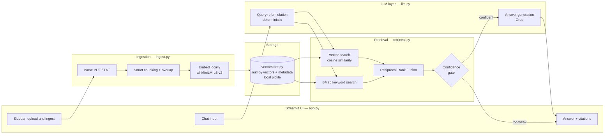
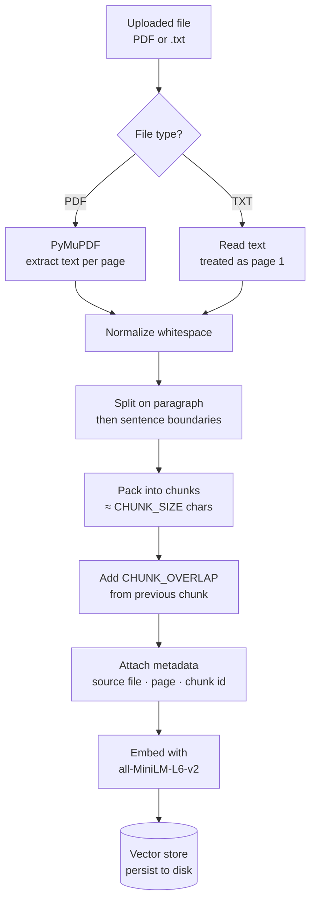
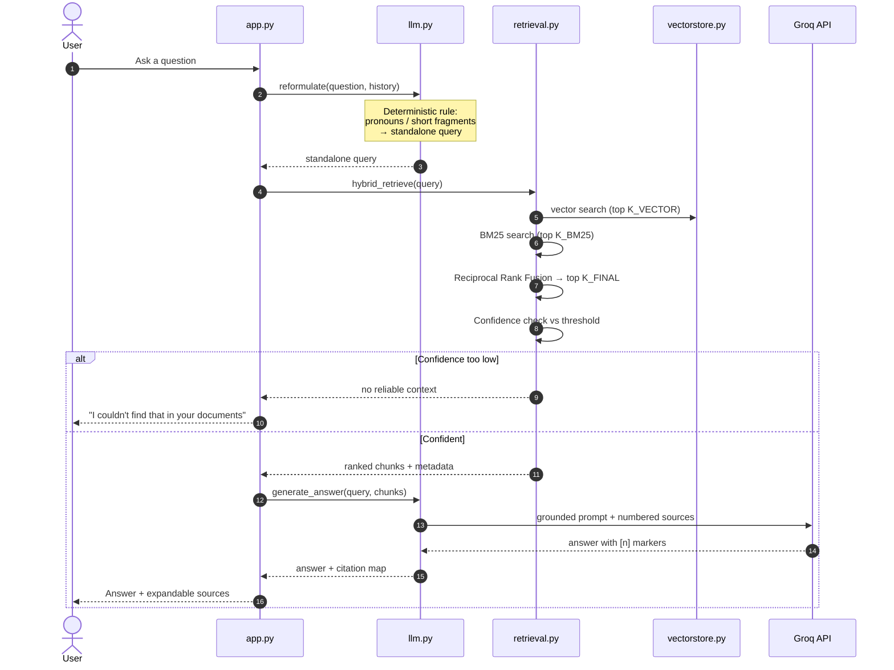
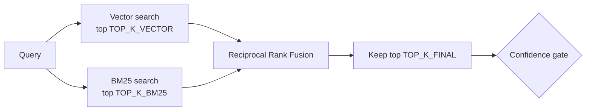
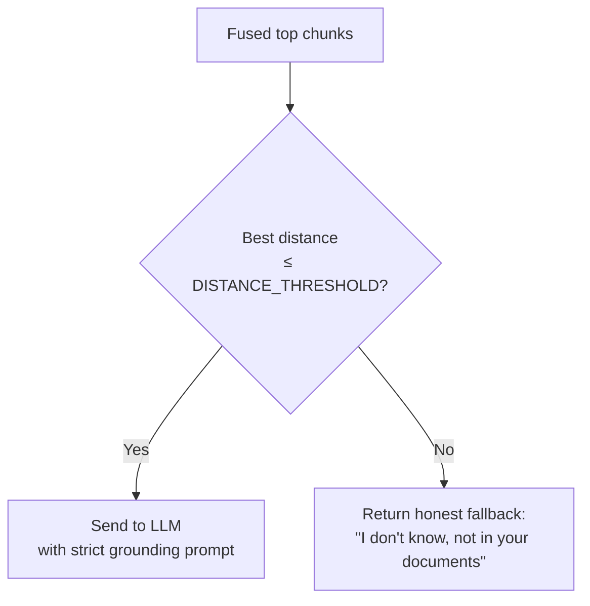
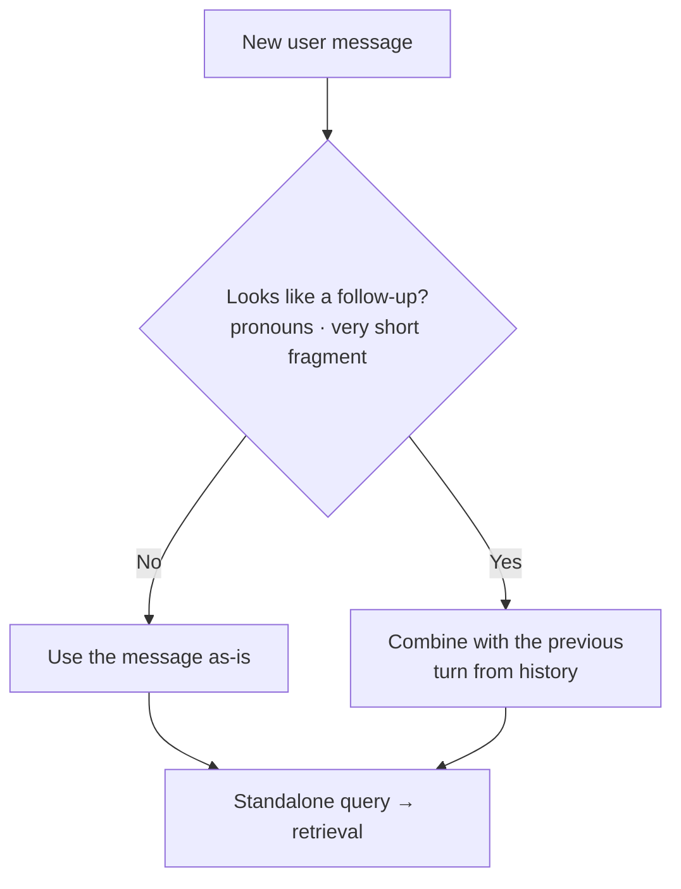
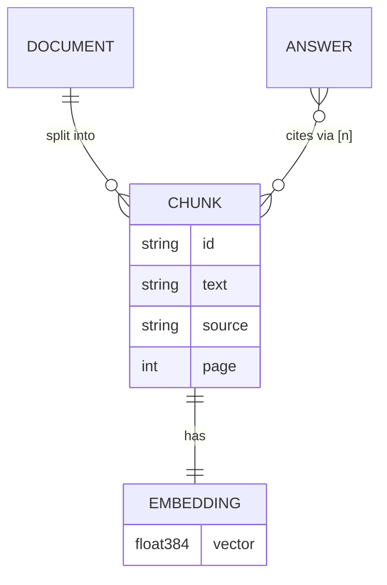

<div align="center">

# DocMind

### Chat with your own documents — grounded in real citations, zero hallucination tolerance.

**A production-minded Retrieval-Augmented Generation (RAG) app** that turns your PDFs and notes into a
searchable, conversational knowledge base — with hybrid retrieval, follow-up memory,
page-accurate citations, and an honest **"I don't know"** when the answer isn't in your files.

<br>

[](#quickstart)
[](#tech-stack)
[-F55036?style=for-the-badge&logo=lightning&logoColor=white)](#tech-stack)
[](#tech-stack)
[](#why-docmind)
[](#license)

<br>



<sub>Replace <code>docs/screenshot.png</code> with your own screenshot (or <code>docs/demo.gif</code>) — it renders automatically here and on GitHub.</sub>

<br><br>

[**Why DocMind**](#why-docmind) ·
[**Features**](#features) ·
[**Architecture**](#architecture) ·
[**Quickstart**](#quickstart) ·
[**Configuration**](#configuration--tuning) ·
[**Design decisions**](#design-decisions--trade-offs) ·
[**Roadmap**](#roadmap)

</div>

<br>

---

## Table of contents

- [Why DocMind](#why-docmind)
- [Features](#features)
- [How it works (30-second version)](#how-it-works-30-second-version)
- [Architecture](#architecture)
  - [System overview](#1-system-overview)
  - [Ingestion pipeline](#2-ingestion-pipeline)
  - [Query pipeline](#3-query-pipeline)
  - [Hybrid retrieval & Reciprocal Rank Fusion](#4-hybrid-retrieval--reciprocal-rank-fusion)
  - [Confidence gate](#5-confidence-gate)
  - [Conversation memory](#6-conversation-memory)
  - [Data model](#7-data-model)
- [Tech stack](#tech-stack)
- [Quickstart](#quickstart)
- [Using the app](#using-the-app)
- [Configuration & tuning](#configuration--tuning)
- [Project structure](#project-structure)
- [Module reference](#module-reference)
- [Design decisions & trade-offs](#design-decisions--trade-offs)
- [Why no ChromaDB?](#why-no-chromadb)
- [Privacy & data handling](#privacy--data-handling)
- [Deploying for free](#deploying-for-free)
- [Troubleshooting](#troubleshooting)
- [FAQ](#faq)
- [Talking points for interviews](#talking-points-for-interviews)
- [Roadmap](#roadmap)
- [Contributing](#contributing)
- [License](#license)

<br>

---

## Why DocMind

Most "chat with your PDF" demos either hallucinate confidently or bolt on a
paid vector database you don't need for a personal document set. DocMind is
built to be **honest, inspectable, and free**:

| Principle | What it means in practice |
|---|---|
| **Grounded, not guessed** | Every claim in an answer is backed by a citation you can open and verify against the exact source file and page. |
| **Hybrid retrieval** | Semantic search *and* exact keyword search, fused together — it handles vague conceptual questions *and* precise names, dates and IDs. |
| **Knows when it doesn't know** | A confidence gate refuses to answer rather than inventing something plausible-sounding. |
| **Inspectable end to end** | No black boxes: the vector store is ~80 lines of numpy, and every tunable lives in one `config.py`. |
| **Genuinely $0** | Local embeddings, a hand-built vector store, and Groq's free-tier LLM. No paid API keys, no compiled C++ dependencies, no credit card. |

<br>

---

## Features

| # | Feature | What it actually does |
|---|---|---|
| 1 | **Smart chunking with overlap** | Splits documents on paragraph/sentence boundaries — not blind character cuts — with overlapping context so information isn't lost at chunk edges. |
| 2 | **Source citations** | Every answer includes `[1]`, `[2]`-style markers that map straight back to the exact source file **and page number**. |
| 3 | **Hybrid search** | Dense vector search (semantic meaning) + BM25 keyword search (exact terms/names/dates), merged with Reciprocal Rank Fusion. Catches both *"what did I write about motivation"* and *"what's my AWS account ID"* style queries. |
| 4 | **Conversation memory** | Follow-ups like *"what about the second one?"* get rewritten into a standalone query using a deterministic rule (pronouns, short fragments) instead of a fragile LLM rewrite — chosen after testing showed small models invent wrong connections. |
| 5 | **Confidence-based fallback** | If retrieval similarity is too low, DocMind says so instead of letting the LLM hallucinate an answer. |

### Also included

- **PDF + plain-text ingestion** with page-aware extraction (PyMuPDF), so citations point to real pages.
- **Persistent local index** — ingest once, query forever; the store is saved to a local pickle file.
- **Zero-build UI** — a Streamlit app with sidebar upload, one-click ingestion and a chat interface.
- **CLI bulk ingest** — drop files in `data/` and run `python ingest.py`.
- **Single source of truth for settings** — chunk sizes, top-k values, thresholds and history length all live in `config.py`.
- **Secrets-friendly** — `.env` for local dev, Streamlit **Secrets** for deployment.

<br>

---

## How it works (30-second version)

1. **Ingest** — your files are parsed page by page, split into overlapping chunks, embedded locally with `all-MiniLM-L6-v2`, and saved with metadata (file, page, text).
2. **Ask** — your question is (if it's a follow-up) turned into a standalone query by a deterministic rule.
3. **Retrieve** — the query runs through **two** retrievers in parallel: vector similarity and BM25 keywords. Results are merged with **Reciprocal Rank Fusion**.
4. **Gate** — if the best match is too weak, DocMind answers *"I couldn't find this in your documents."*
5. **Generate** — otherwise the top chunks are handed to the Groq LLM with strict instructions to answer **only** from them and cite with `[n]` markers.
6. **Verify** — the UI shows the answer with expandable sources so you can check every claim.

<br>

---

## Architecture

### 1. System overview



The same flow as plain text, for terminals and quick reading:

```
                 ┌──────────────┐
   PDF/TXT  ───► │   ingest.py  │  chunk (overlap) → embed → store
                 └──────┬───────┘
                        │
                        ▼
                 ┌──────────────┐
                 │ vectorstore  │  numpy cosine search + metadata,
                 │    .py       │  persisted to a local pickle file
                 └──────┬───────┘
                        │
   query ──► reformulate (llm.py) ──► hybrid_retrieve (retrieval.py)
                                            │
                              vector search ┼ BM25 search
                                            │
                                   Reciprocal Rank Fusion
                                            │
                                  confidence check (Feature 5)
                                            │
                                            ▼
                                   generate_answer (llm.py)
                                            │
                                            ▼
                                  answer + citations (app.py)
```

### 2. Ingestion pipeline



**Why it's built this way**

- **Page-aware parsing** — text is extracted page by page so every chunk knows which page it came from. That is what makes *page-level* citations possible.
- **Boundary-respecting chunking** — splitting on paragraphs, then sentences, avoids cutting a thought in half. Fixed-size character splitting routinely severs sentences and degrades both embeddings and answers.
- **Overlap** — the tail of one chunk is repeated at the head of the next, so a fact that straddles a boundary is still fully contained in at least one chunk.
- **Local embeddings** — nothing about your documents leaves your machine during indexing.

### 3. Query pipeline



### 4. Hybrid retrieval & Reciprocal Rank Fusion

Each retriever has a blind spot:

| Retriever | Great at | Weak at |
|---|---|---|
| **Dense vectors** (semantic) | Paraphrases, concepts, "what did I write about *motivation*" | Exact strings: names, IDs, dates, rare tokens |
| **BM25** (keyword) | Exact terms: *"AWS account ID"*, invoice numbers, acronyms | Synonyms and conceptual phrasing |

DocMind runs **both** and merges the ranked lists with **Reciprocal Rank Fusion (RRF)**:

```
score(chunk) = Σ over retrievers   1 / (k + rank_in_that_retriever)
```

- A chunk that ranks well in **either** list is boosted; one that ranks well in **both** rises to the top.
- RRF only uses **ranks**, not raw scores — so it needs no score normalization between cosine similarity and BM25, which live on completely different scales.
- No re-ranker model, no extra API call, no added latency worth noticing.



### 5. Confidence gate

Retrieval always returns *something* — even for a question your documents have nothing to say about. Feeding weak matches to an LLM is exactly how hallucinations happen. So DocMind checks the **best vector distance** against `DISTANCE_THRESHOLD` **before** calling the LLM:



| Threshold | Behaviour | Risk |
|---|---|---|
| **Lower** (stricter) | Refuses more often | May reject valid but awkwardly worded questions |
| **Higher** (looser) | Answers more often | May answer from marginally relevant text |

The default (`0.9`) is a starting point — tune it against your own documents (see [Tuning knobs](#configuration--tuning)).

### 6. Conversation memory

Follow-up questions such as *"what about the second one?"* or *"and when was that?"* are meaningless to a retriever on their own. DocMind rewrites them into a **standalone query** using recent chat history (up to `MAX_HISTORY_TURNS`).

**Deliberately deterministic.** An LLM-based rewriter was tried first and tested poorly: small, fast models confidently invented connections between unrelated turns, which silently corrupted retrieval. The final design uses a simple rule-based approach — detect pronouns and short fragments, then anchor them to the prior turn — trading some cleverness for **predictability and robustness**.



### 7. Data model

Every chunk stored in the vector store carries the metadata needed to produce a citation:

```
Chunk
├── id          unique chunk identifier
├── text        the chunk's content (what the LLM reads)
├── embedding   384-dim vector (all-MiniLM-L6-v2)
└── metadata
    ├── source  originating file name
    └── page    page number (for citations)
```



The whole store lives in a single local **pickle** file: a numpy matrix of embeddings plus a parallel list of chunk texts and metadata. Search is a normalized dot product (cosine similarity) over that matrix — fast enough for personal-scale corpora with no index-building step.

<br>

---

## Tech stack

<div align="center">

| Layer | Choice | Why |
|---|---|---|
| UI | **Streamlit** | Fast, free hosting, zero frontend build step |
| Embeddings | **`all-MiniLM-L6-v2`** (local) | Small, fast, runs on CPU, no API cost |
| Vector store | **Hand-built numpy store** | No `chroma-hnswlib` C++ build step — pure `pip install numpy` |
| Keyword search | **`rank-bm25`** | Lightweight BM25 for exact-match queries |
| Fusion | **Reciprocal Rank Fusion** | Merges vector + keyword results without a re-ranker model |
| LLM | **Groq (free tier)** | Fast inference, generous free quota |
| PDF parsing | **PyMuPDF** | Page-aware extraction for accurate citations |
| Config | **`config.py` + `.env`** | One place for every tunable; secrets stay out of git |

</div>

<br>

---

## Quickstart

**Prerequisites:** Python 3.10+ and a free Groq API key.

```bash
# 1. Clone the repo
git clone https://github.com/<your-username>/docmind.git
cd docmind

# 2. (Recommended) create a virtual environment
python -m venv .venv
source .venv/bin/activate        # Windows: .venv\Scripts\activate

# 3. Install dependencies
pip install -r requirements.txt

# 4. Get a free Groq API key → https://console.groq.com/keys (no card required)

# 5. Configure environment
cp .env.example .env
# then paste your GROQ_API_KEY into .env

# 6. Run it
streamlit run app.py
```

Open the URL Streamlit prints (usually `http://localhost:8501`), upload a
PDF or `.txt` file from the sidebar, hit **Ingest documents**, and start
asking questions.

### Environment variables

| Variable | Required | Description |
|---|---|---|
| `GROQ_API_KEY` | Yes | Your free key from the Groq console. |
| `GROQ_MODEL` | No (optional) | Override the default Groq model name. |

<details>
<summary><b>Optional: bulk ingest via CLI</b></summary>
<br>

Drop files into the `data/` folder and run:

```bash
python ingest.py
```

This parses, chunks, embeds and stores everything in `data/` without opening the UI — handy for large folders or scripted setups.

</details>

<br>

---

## Using the app

1. **Upload** — use the sidebar to add one or more PDFs or `.txt` files.
2. **Ingest** — click **Ingest documents**. The first run downloads the embedding model once (a few tens of MB), then indexing runs fully locally.
3. **Ask** — type a question in the chat box. Be as natural as you like.
4. **Verify** — open the sources under each answer. Every `[n]` marker maps to a file and page so you can check the claim yourself.
5. **Follow up** — ask *"what about the second one?"* — memory resolves it for you.

**Example questions**

| Type | Example | Retriever doing the heavy lifting |
|---|---|---|
| Conceptual | *"What did I write about motivation?"* | Vector (semantic) |
| Exact lookup | *"What's my AWS account ID?"* | BM25 (keyword) |
| Follow-up | *"And what about the second one?"* | Memory → hybrid |
| Out of scope | *"Who won the 1998 World Cup?"* | Confidence gate → "I don't know" |

<br>

---

## Configuration & tuning

Everything that affects retrieval quality lives in `config.py`:

| Setting | Default | Effect |
|---|---|---|
| `CHUNK_SIZE` / `CHUNK_OVERLAP` | `800` / `150` | Larger chunks = more context per citation, fewer total chunks |
| `TOP_K_VECTOR` / `TOP_K_BM25` / `TOP_K_FINAL` | `10` / `10` / `8` | How many candidates each retriever pulls before fusion |
| `DISTANCE_THRESHOLD` | `0.9` | Lower = stricter "I don't know" gate; higher = more willing to answer |
| `MAX_HISTORY_TURNS` | `4` | How much chat history feeds query reformulation |

### Tuning cookbook

| Symptom | Likely cause | Try |
|---|---|---|
| Says "I don't know" on questions it *should* answer | Gate too strict | Raise `DISTANCE_THRESHOLD` |
| Answers confidently from loosely related text | Gate too loose | Lower `DISTANCE_THRESHOLD` |
| Answers feel cut off / missing context | Chunks too small | Raise `CHUNK_SIZE` |
| Facts split across two chunks get missed | Overlap too small | Raise `CHUNK_OVERLAP` |
| Exact IDs / names not found | Not enough keyword candidates | Raise `TOP_K_BM25` |
| Prompt too long / slow answers | Too many chunks sent to the LLM | Lower `TOP_K_FINAL` |

> After changing `CHUNK_SIZE` or `CHUNK_OVERLAP`, **re-ingest** your documents so the stored chunks match the new settings.

<br>

---

## Project structure

```
docmind/
├── app.py               # Streamlit UI — ties all 5 features together
├── ingest.py            # PDF/text parsing, chunking, embedding, storage
├── vectorstore.py       # Self-built numpy cosine-similarity vector store
├── retrieval.py         # Hybrid search (vector + BM25) + confidence check
├── llm.py               # Groq API calls, query reformulation, citations
├── config.py            # All tunable settings in one place
├── requirements.txt
├── .env.example
├── .streamlit/
│   └── config.toml      # App theme
├── docs/
│   └── screenshot.png   # ← drop your app screenshot here
└── data/                # Uploaded documents land here
```

<br>

---

## Module reference

| Module | Responsibility | Depends on |
|---|---|---|
| **`app.py`** | Streamlit UI: sidebar upload & ingest, chat loop, rendering answers and expandable citations. Orchestrates all five features. | `ingest`, `retrieval`, `llm`, `config` |
| **`ingest.py`** | Parse PDF/TXT (page-aware), chunk with overlap, embed, and write to the store. Also runnable as a CLI for bulk ingest. | `vectorstore`, `config` |
| **`vectorstore.py`** | A minimal vector database: `add` embeddings + metadata, `search` by cosine similarity, `persist`/`load` to a local pickle. | `numpy` |
| **`retrieval.py`** | Hybrid retrieval: vector search + BM25, Reciprocal Rank Fusion, and the confidence check. | `vectorstore`, `rank-bm25`, `config` |
| **`llm.py`** | Groq client calls, deterministic query reformulation, grounded prompt construction and citation formatting. | `groq`, `config` |
| **`config.py`** | Single source of truth for chunking, retrieval, threshold, history and model settings. | — |

<br>

---

## Design decisions & trade-offs

| Decision | Alternative | Why this way |
|---|---|---|
| **Hand-built numpy vector store** | ChromaDB / FAISS / a hosted vector DB | Zero compile step, zero cost, ~80 lines you can fully read. Brute-force cosine is plenty fast for personal-scale document sets. |
| **Hybrid (vector + BM25) retrieval** | Vector-only | Pure semantic search misses exact names, IDs and dates. BM25 covers that gap cheaply. |
| **Reciprocal Rank Fusion** | Weighted score blending or a cross-encoder re-ranker | Rank-based, so no score normalization across incompatible scales; no extra model to run. |
| **Deterministic query rewriting** | LLM-based rewriting | Small/fast LLMs invented wrong connections in testing. A rule is predictable and debuggable. |
| **Confidence gate before generation** | Always generate | Prevents the LLM from inventing an answer when retrieval found nothing relevant. |
| **Local embeddings** | Hosted embedding API | No cost, no rate limits, and document text never leaves your machine at index time. |
| **Boundary-aware chunking + overlap** | Fixed-size character splits | Preserves sentences and cross-boundary context, improving both retrieval and answers. |

**Known limitations (by design)**

- Brute-force search scales linearly with corpus size — ideal for personal/small collections, not millions of chunks.
- The index is a local pickle: single-user, single-machine, no concurrent writers.
- Scanned/image-only PDFs have no extractable text without OCR (not currently included).

<br>

---

## Why no ChromaDB?

An earlier version used ChromaDB, but its `chroma-hnswlib` dependency needs a
C++ compiler to build from source on Windows unless you install Visual C++
Build Tools. Since this project is meant to be a **zero-friction, zero-cost**
demo, `vectorstore.py` implements the same core idea — store embeddings,
search by similarity, keep metadata for citations — in ~80 lines of plain
numpy. No compiler required, and it's a genuinely good interview talking
point: you understand what a vector index does under the hood instead of
treating it as a black box.

<br>

---

## Privacy & data handling

| Stage | Where it runs | What leaves your machine? |
|---|---|---|
| Parsing & chunking | Local | Nothing |
| Embedding | Local (`all-MiniLM-L6-v2` on CPU) | Nothing |
| Vector store | Local pickle file | Nothing |
| Retrieval (vector + BM25) | Local | Nothing |
| Answer generation | Groq API | **Only the question and the top retrieved chunks** |

- Your full documents are **never** uploaded wholesale — only the handful of relevant passages needed to answer each question are sent to the LLM.
- Keep `.env` out of version control (it's meant to be git-ignored). On deployment, use the platform's **Secrets** panel instead.
- Treat the `data/` folder and the persisted index as sensitive if your documents are.

<br>

---

## Deploying for free

1. Push this repo to GitHub.
2. Deploy on [Streamlit Community Cloud](https://streamlit.io/cloud) — free tier.
3. Add `GROQ_API_KEY` (and optionally `GROQ_MODEL`) under the app's **Secrets**
   panel instead of committing `.env`.

That's the whole deployment story — no infra, no Docker, no paid tier required.

> Community-cloud filesystems can be ephemeral: documents ingested in a hosted session may need re-ingesting after the app restarts.

<br>

---

## Troubleshooting

| Problem | Fix |
|---|---|
| `GROQ_API_KEY` missing / auth error | Make sure `.env` exists (copied from `.env.example`) and contains your key; on Streamlit Cloud, set it under **Secrets**. |
| First ingest is slow | The embedding model downloads once on first use; subsequent runs are fast. |
| `pip install` fails on a compiler error | DocMind deliberately avoids C++-built dependencies — make sure you're using the repo's `requirements.txt` and Python 3.10+. |
| Answers say "I don't know" too often | Raise `DISTANCE_THRESHOLD` in `config.py`. |
| Citations point to the wrong page | Re-ingest the document; confirm it's a text-based PDF (scanned PDFs lack extractable text). |
| Changed chunk settings but nothing changed | Re-ingest — existing chunks keep the old settings. |
| Rate-limit errors from Groq | You've hit the free-tier quota; wait a moment or set a different `GROQ_MODEL`. |

<br>

---

## FAQ

<details>
<summary><b>Does it really cost nothing?</b></summary>
<br>
Yes. Embeddings run locally, the vector store is plain numpy, and Groq's free tier covers generation. No credit card is required.
</details>

<details>
<summary><b>Can it handle hundreds of pages?</b></summary>
<br>
Yes — brute-force cosine search over a few thousand chunks is effectively instant. It's designed for personal and small-team document sets.
</details>

<details>
<summary><b>Why does it sometimes refuse to answer?</b></summary>
<br>
That's the confidence gate working as intended. If nothing in your documents is similar enough to the question, DocMind would rather say so than guess. Tune <code>DISTANCE_THRESHOLD</code> if it's too cautious for your content.
</details>

<details>
<summary><b>Can I swap the LLM?</b></summary>
<br>
Generation is isolated in <code>llm.py</code>, so changing providers or models is a contained change. For a different Groq model, just set <code>GROQ_MODEL</code>.
</details>

<details>
<summary><b>Can I use it on scanned PDFs?</b></summary>
<br>
Not out of the box — scanned PDFs are images with no text layer. Adding an OCR step before chunking would enable it.
</details>

<br>

---


<br>

---

## Roadmap

- [ ] Cross-encoder re-ranking on top of the fused candidates
- [ ] Streaming responses token-by-token
- [ ] Retrieval evaluation harness (recall@k, answer faithfulness)
- [ ] Multi-user / multi-workspace document isolation
- [ ] OCR support for scanned PDFs
- [ ] Additional formats (DOCX, Markdown, HTML)
- [ ] ANN indexing (HNSW) for very large corpora

<br>

---

## Contributing

Contributions, issues and ideas are welcome.

1. Fork the repo and create a feature branch.
2. Keep new tunables in `config.py` rather than hard-coding them.
3. Prefer small, readable modules — the project's charm is that you can read all of it in an afternoon.
4. Open a pull request describing the change and, for retrieval changes, how it affected answer quality.

<br>

---

## License

MIT — use it, fork it, put it in your portfolio.

<div align="center">
<br>
<sub>Built with local embeddings, hybrid search, and $0 in API costs.</sub>
<br><br>
<b>If DocMind helped you, consider leaving a star</b>
</div>